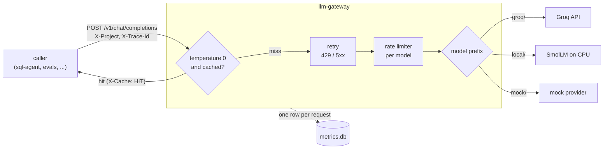

# llm-gateway

**Proves:** "LLM-native metrics (e.g., tokens/sec, cost-per-request)"

An OpenAI-compatible gateway that every project in this portfolio calls instead of calling Groq directly. Rate limits, retries, caching and per-request metrics live in one place, so every later project (SQL agent, evals, MCP server, trace review) gets them for free and is measured the same way.

## Demo
_TBD: 1-minute recording of a benchmark run, the cached re-run, and `gateway stats`._

## How it works



The order of the layers is the main design decision:

- **Cache first.** A hit costs no quota and never waits behind the rate limiter.
- **Retry wraps the rate limiter.** Groq counts every attempt against the per-minute limits, so every retry waits for budget like a new request.
- **Metrics in `finally`.** Every request writes exactly one row, including failures, cache hits and requests the limiter refused.

Each layer in more detail:

| Layer | What it does | Why |
|---|---|---|
| Router | `groq/<id>` → Groq, `local/<hf-id>` → SmolLM, `mock/<name>` → fake. Splits on the first `/` only (`groq/openai/gpt-oss-20b`). | Callers switch models by changing one string. |
| Cache | SQLite. Key = sha256 of the canonical JSON of every request field that can change the answer (model, messages, tools, tool_choice, response_format, max_tokens, seed, ...). Only `temperature == 0` is cached. | If an input is missing from the key, two different requests share an answer. If an irrelevant one is included, the cache never hits. Unset temperature means the provider default (1.0), so it isn't cached. |
| Retry | Retries 429 and 5xx up to 5 attempts. Waits as long as `retry-after` says (plus up to 10% jitter); without it, uses exponential backoff with full jitter. Other 4xx errors are never retried. A `retry-after` over 60 s fails fast. | Jitter stops clients that failed together from retrying together. A daily quota shouldn't hold an HTTP request open for an hour. |
| Rate limiter | Per model: token buckets for requests/min and tokens/min (wait), and 24 h sliding windows for requests/day and tokens/day (refuse with 429). Each call reserves an estimate (cl100k prompt count + completion budget), and `reconcile` corrects it with the real `usage` afterwards. On restart, daily windows are rebuilt from the metrics table. | Groq's limits are per model, so each model's budget is tracked separately. Slowing down before Groq has to say 429 is cheaper than retrying after it does. |
| Groq provider | Plain `httpx`, with no SDK. | Status codes and `retry-after` stay visible to our retry layer, and there's no hidden second retry loop. |
| Metrics | One SQLite row per request. `tokens_per_sec` uses Groq's `usage.completion_time`, falling back to wall-clock time. `est_cost_usd` uses paid-tier prices from `config/pricing.yaml`. | The free tier costs $0. What the same traffic would cost on the paid tier is the number that matters. |

`latency_ms` is the model call alone (or the cache lookup on a hit). `total_ms` also includes rate-limit waits and retries. Keeping them separate means the gateway's own throttling doesn't inflate the model latency numbers.

## Results

Benchmark: 50 fixed prompts per model at temperature 0, capped at 512 output tokens. There are 20 short (~9 tokens), 20 medium (~170) and 10 long (~1,600). See [scripts/benchmark_prompts.json](scripts/benchmark_prompts.json). One untimed warm-up call per model runs first, so one-off costs (TLS setup, a local model load) stay out of p95.

_Pending the first run with a Groq key (`just bench`, then paste the table here):_

| model | requests | cache hit % | p50 ms | p95 ms | tokens/s | $/1K req | error % |
|---|---|---|---|---|---|---|---|
| groq/openai/gpt-oss-20b | | | | | | | |
| groq/openai/gpt-oss-120b | | | | | | | |
| groq/qwen/qwen3.8-27b | | | | | | | |

What failed at first, and how it was fixed:

- **Two Llama models went enterprise-only.** The plan compared Llama 3.1 8B and Llama 3.3 70B. By October 2026 Groq lists both as Enterprise-only, so the free-tier comparison is gpt-oss-20b vs gpt-oss-120b vs qwen3.8-27b (preview). Model IDs live in `config/`, so this was a config change, not a code change.
- **A rounding error hung the rate limiter.** A rate-limiter test hung because, after a refill, the bucket held 0.9999999 tokens for a 1-token request. Each retry slept for a time too small to move the clock, forever. The fix is a 1e-6 tolerance in the bucket check, and the test now covers it.
- **A one-time model load wrecked p95.** The first local SmolLM run reported p95 = 230 s over 3 requests, because the first call included a ~4-minute torch import and weight load. The benchmark now makes one untimed warm-up call per model, and the local provider times `generate()` only.
- **Tests downloaded the tokenizer every run.** The test suite re-downloaded tiktoken's vocabulary on every run (28 s). Now there's one cache directory in the repo, and CI caches it.

## Run it

Needs Python 3.11+, [uv](https://docs.astral.sh/uv/) and [just](https://just.systems) (`uv tool install rust-just`).

```
git clone https://github.com/Zubariya-Suleka/llm-gateway
cd llm-gateway
cp .env.example .env     # then add your GROQ_API_KEY
just setup
just test
just run                 # http://127.0.0.1:8000
```

Call it like the OpenAI API:

```
curl http://127.0.0.1:8000/v1/chat/completions \
  -H "Content-Type: application/json" -H "X-Project: demo" \
  -d '{"model": "groq/openai/gpt-oss-20b", "temperature": 0,
       "messages": [{"role": "user", "content": "Say hi"}]}'
```

The OpenAI Python SDK also works: `OpenAI(base_url="http://127.0.0.1:8000/v1", api_key="unused")`.

Measure:

```
just bench                       # 50 prompts x models in config/models.yaml (spends Groq quota)
just bench --models mock/bench   # same pipeline, no key, no quota
just bench                       # again: ~100% cache hits, ~0 ms
just stats 1d                    # or: uv run gateway stats --since 7d --project sql-agent --markdown
```

Without a key, these work:
- `mock/<anything>` returns a canned reply after a sampled latency.
- `mock/fail-429` and `mock/fail-500` always fail, which is handy for testing retries.
- For a local model, run `just setup-local` (CPU-only torch) and use `local/HuggingFaceTB/SmolLM2-360M-Instruct`. Weights download to wherever `HF_HOME` points.

### API

| | |
|---|---|
| `POST /v1/chat/completions` | OpenAI request and response shape. Supports `tools`, `tool_choice`, `response_format`, `temperature`, `max_tokens`/`max_completion_tokens`. Unknown fields (e.g. `reasoning_effort`) pass through to the provider. Non-streaming only. |
| `GET /healthz` | `{"status": "ok", "version": ..., "groq_key_configured": ...}` |
| Request headers | `X-Project` (which repo is calling), `X-Trace-Id` (ties gateway rows to an agent run) |
| Response headers | `X-Cache: HIT \| MISS \| BYPASS` (BYPASS = not cacheable), `X-Attempts` |
| Errors | OpenAI-style `{"error": {"message", "type", "code"}}`. Limiter refusals are 429 with `Retry-After`. |

### Configuration

- `.env`: secrets and settings ([config.py](src/llm_gateway/config.py) lists them all)
- [config/limits.yaml](config/limits.yaml): RPM / TPM / RPD / TPD per model (`groq/*` is the fallback)
- [config/pricing.yaml](config/pricing.yaml): USD per 1M input and output tokens
- [config/models.yaml](config/models.yaml): the models the benchmark runs

### Metrics table

`requests` in `data/metrics.db`: `id, ts, project, trace_id, provider, model, status, cache_hit, attempts, prompt_tokens, completion_tokens, latency_ms, total_ms, completion_time_s, tokens_per_sec, est_cost_usd, error`.

## What I'd do next

- Read Groq's `x-ratelimit-remaining-*` headers to correct the limiter's estimates. Limits are kept in process memory today, which is fine for one gateway process but wrong for two.
- Record the model version with each cache entry, or add a TTL, so a silent model update behind the same name doesn't keep serving old answers.
